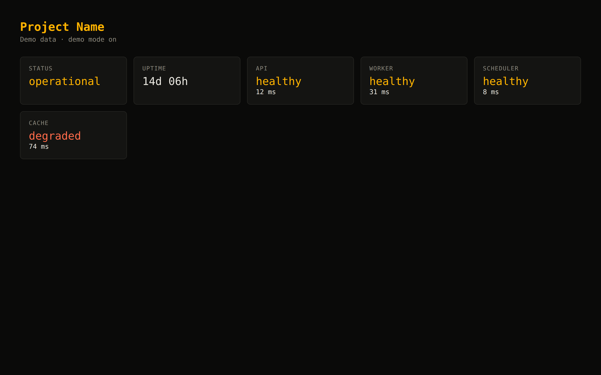

<div align="center">


# msprex

**MSP automation engine — PowerShell-based remote management, scripted deployments, monitoring checks, and client provisioning for managed service providers.**

*Formerly MSPEngine.*

[](https://github.com/OneByJorah/msprex/releases)
[](https://github.com/OneByJorah/msprex/actions/workflows/ci.yml)
[](https://www.docker.com/)
[](https://opensource.org/licenses/MIT)



</div>

## What This Is

msprex is an MSP automation engine with two halves:

1. **A PowerShell module** (`msprex/`) for remote host management from a Windows workstation — host info, scripted deployments, scheduled health checks, and client records against machines you administer.
2. **A self-hosted demo dashboard** (`app/`) — a small Node service that renders the ops status board above. It ships with demo data and runs anywhere Docker runs, including the included compose file.

## Quick Start (dashboard)

```bash
git clone https://github.com/OneByJorah/msprex.git
cd msprex
cp .env.example .env   # optional; defaults are fine
docker compose up -d --build
```text

Open `http://127.0.0.1:8080` — it binds to localhost only. Health: `curl http://127.0.0.1:8080/healthz` → `200`.

Environment (see `.env.example`): `HOST_PORT` (default `8080`), `DEMO_MODE` (default `true`), `PROJECT_NAME` (default `msprex`).

## Quick Start (PowerShell module — Windows)

The module targets Windows hosts (CIM / `Invoke-Command` against machines you administer). On a Windows PowerShell 5.1+ session:

```powershell
git clone https://github.com/OneByJorah/msprex.git
cd msprex
Import-Module ./msprex/msprex.psd1
Get-Command -Module msprex
```text

> **Note:** the module is Windows-only — it uses CIM sessions and PowerShell remoting that do not exist on Linux/macOS. The Docker dashboard above runs on any OS.

### Install the Windows package (MSI)

Download `msprex-<version>-x64.msi` from [Releases](https://github.com/OneByJorah/msprex/releases). It installs the module for all users into `%ProgramFiles%\WindowsPowerShell\Modules\msprex`, which is already on `PSModulePath`, so no profile edits are needed:

```powershell
msiexec /i msprex-1.0.0-x64.msi /qn
Import-Module msprex
Get-Command -Module msprex
```

Remove it the same way: `msiexec /x msprex-1.0.0-x64.msi /qn`. Upgrades replace the previous version in place — the UpgradeCode is fixed, so installs do not stack.

Every release states its signing status. Without a `WINDOWS_CERT_PFX_BASE64` secret the package is **unsigned**, so SmartScreen warns on first run (More info → Run anyway); `SHA256SUMS.txt` in the release is then the only integrity check. Build the package locally:

```powershell
# WiX 3.14 binaries on PATH, or pass -WixBin <dir>
pwsh -File installer\build.ps1
pwsh -File installer\verify-msi.ps1 -Msi dist\msprex-1.0.0-x64.msi -SourceDir msprex -WixBin <dir>
```

`build.ps1` refuses to package a version that does not match `ModuleVersion` in `msprex/msprex.psd1`, and `verify-msi.ps1` inspects the built MSI without installing it: product identity, install layout, and the SHA-256 of each file inside the embedded cabinet.

## Functions

| Function | Description |
| -------- | ----------- |
| `Get-MSPHost` | Get host info from a remote computer |
| `Invoke-MSPDeploy` | Deploy a script to a remote computer |
| `Test-MSPHealth` | Check host health (CPU, memory, status) |
| `New-MSPClient` | Create a new client record |

## Repository Layout

```text
msprex/        PowerShell module (manifest + psm1)
app/           Demo dashboard (Node, no dependencies)
installer/     WiX source for the MSI, plus build and verification scripts
install.sh     Linux/macOS helper (dashboard)
install.ps1    Windows helper (module import + dashboard)
docker-compose.yml
```text

## Contributing

[Open an issue](https://github.com/OneByJorah/msprex/issues) for bugs or feature requests. PRs welcome — keep the demo data fictional.

## License

MIT — see [LICENSE](LICENSE).
